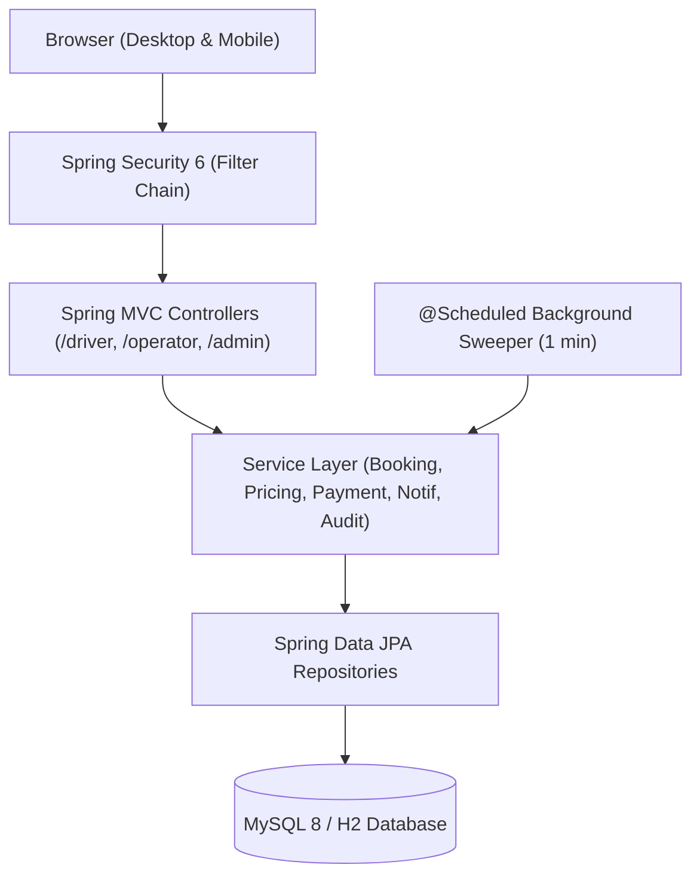
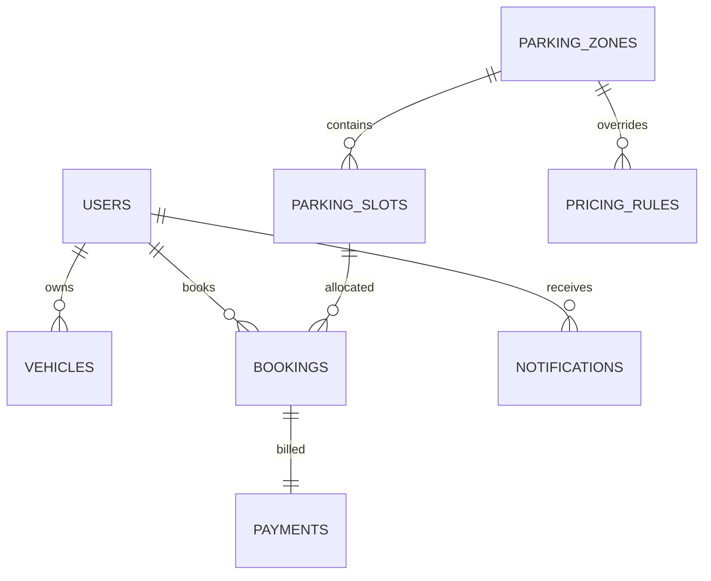

# SmartPark – Smart Parking Management System
> **Park Smarter | Save Time | Move Better**

SmartPark is an enterprise-grade, full-stack centralized parking management web platform connecting **Drivers**, **Parking Operators**, and **Administrators** for live slot discovery, concurrency-safe reservations, visual occupancy tracking, dynamic tariff calculation, and digital billing.

---

## 📌 Table of Contents
1. [System Overview](#system-overview)
2. [Key Features by Role](#key-features-by-role)
3. [Technology Stack](#technology-stack)
4. [System Architecture](#system-architecture)
5. [Entity Relationship Diagram](#entity-relationship-diagram)
6. [Monorepo Project Structure](#monorepo-project-structure)
7. [Local Quick Start](#local-quick-start)
8. [Docker & Containerization](#docker--containerization)
9. [Deployment Guide (Render & Vercel)](#deployment-guide-render--vercel)
10. [Default Credentials](#default-credentials)
11. [Route & Endpoint Directory](#route--endpoint-directory)
12. [Future Roadmap](#future-roadmap)

---

## 1. System Overview
Urban transit centers, office plazas, and shopping hubs suffer from parking bottlenecks due to lack of visibility into slot vacancies and manual ticketing. SmartPark resolves this with:
- **Zero Double-Bookings:** Combining pessimistic database row-locking (`PESSIMISTIC_WRITE`) with JPA `@Version` optimistic concurrency and temporal collision queries.
- **Automated Grace-Period Sweeper:** Background Spring `@Scheduled` cron job clearing expired reservations after 15 minutes of scheduled entry time.
- **Dynamic Tariff Engine:** Ceiling-rounded hourly rates with vehicle-type baselines and zone-specific overrides plus 15-minute grace windows.
- **Digital QR Booking Passes:** Real-time ZXing Base64 QR code generation for gate validation and printable invoice receipts.

---

## 2. Key Features by Role

### 🚗 Driver Portal (`ROLE_DRIVER`)
- **Authentication & Profile:** Driver self-registration, BCrypt-secured login, profile editor, and password reset.
- **Multi-Vehicle Garage:** Register, update, and manage multiple vehicles (Cars, Bikes, EVs, Trucks) with license plate validation.
- **Live Slot Discovery:** Search vacant slots across zones and floors with live vacancy counters, filterable by date-time and vehicle category.
- **Instant Reservation:** Preview estimated parking charges and lock in slots with concurrency guarantees.
- **Digital QR Pass:** Access dedicated pass cards featuring machine-scannable QR codes.
- **Simulated Payment Gateway:** Pay online using interactive test sandbox with simulated success/failure toggle.
- **Printable Receipts:** Printable invoice receipts with transaction details and timestamps.
- **In-App Notification Bell:** Real-time status notifications for booking confirmations, cancellations, check-in, check-out, and payment.

### 👷 Operator Console (`ROLE_OPERATOR`)
- **Operator Dashboard:** Live KPI stat cards (Total Slots, Available, Occupied, Reserved, Maintenance, Today's Bookings, Today's Revenue).
- **Interactive Occupancy Grid:** Color-coded visual map of bays (Green = Available, Amber = Reserved, Red = Occupied, Gray = Maintenance).
- **Gate Check-In & Check-Out:** One-click gate processing transitioning bookings to `ACTIVE` (slot occupied) and `COMPLETED` (slot released).
- **Tariff Recalculation:** Automatic calculation of final billable duration upon vehicle exit.
- **Cash Ledger:** Collect and record on-site cash payments.
- **Zone & Slot CRUD:** Create zones, add bays, or bulk-generate bays with custom prefixes (e.g. `A-01` to `A-20`).

### 🛡️ Admin Console (`ROLE_ADMIN`)
- **Executive Analytics Dashboard:** Chart.js visualizations for Revenue over the last 7 days, Zone Occupancy distribution, and Lifetime Bookings by Status.
- **User & Staff Management:** Create operator accounts, toggle active/blocked account statuses, and reset passwords.
- **Tariff & Pricing Engine:** Configure hourly rates, minimum charges, and free minutes per vehicle category with optional zone overrides.
- **Auditing & Compliance:** Real-time immutable audit trail logging user logins, booking actions, payments, and admin events.
- **Reports & CSV Export:** Filter booking and revenue records by date range with one-click CSV download.

---

## 3. Technology Stack

| Layer | Component | Details |
|---|---|---|
| **Backend** | Java 17 | Spring Boot 3.3.4, Spring MVC, Spring Data JPA, Hibernate |
| **Security** | Spring Security 6 | BCrypt hashing, Form Login, Session Management, Remember-Me, Method Security |
| **Frontend** | Monorepo Server-Rendered | Thymeleaf 3, Thymeleaf Security Extras, HTML5, CSS3, Vanilla JS |
| **UI Framework** | Bootstrap 5.3.3 | Bootstrap Icons, Custom Brand Theme (Deep Blue `#1e3a8a` + Emerald `#10b981`) |
| **Data Viz** | Chart.js 4.4 | Responsive HTML5 canvas charts for executive analytics |
| **QR Engine** | ZXing Core & JavaSE | High-density Base64 Data URI QR generator |
| **Database** | MySQL 8.0 & H2 | H2 In-Memory for development and tests; MySQL 8 for production |
| **DevOps** | Docker & CI/CD | Multi-stage Dockerfile, Docker Compose, GitHub Actions, Render Cloud |

---

## 4. System Architecture



---

## 5. Entity Relationship Diagram



---

## 6. Monorepo Project Structure (Separated Backend & Frontend)

```
smartpark/
├── backend/                       # Java 17 + Spring Boot 3.3.4 REST API & MVC Backend
│   ├── src/
│   │   ├── main/
│   │   │   ├── java/com/smartpark/
│   │   │   │   ├── config/        # SecurityConfig, CorsConfig, DataSeeder
│   │   │   │   ├── controller/    # Web MVC Controllers & REST API Controllers (/api/**)
│   │   │   │   │   └── api/       # AuthApiController, SlotApiController, BookingApiController, etc.
│   │   │   │   ├── dto/           # Strongly-typed Form & View DTOs
│   │   │   │   ├── entity/        # JPA Entities (User, Slot, Booking, etc.)
│   │   │   │   ├── enums/         # Role, Status, VehicleType, PaymentMode
│   │   │   │   ├── exception/     # Custom exceptions & GlobalExceptionHandler
│   │   │   │   ├── repository/    # Spring Data JPA repositories with pessimistic locks
│   │   │   │   ├── scheduler/     # Automated booking expiry background task
│   │   │   │   ├── security/      # CustomUserDetails, SuccessHandler
│   │   │   │   ├── service/       # Service interfaces and implementations
│   │   │   │   └── util/          # ZXing QR Code generator
│   │   │   └── resources/
│   │   │       ├── static/        # Static assets
│   │   │       ├── templates/     # Thymeleaf templates (fragments, auth, driver, operator, admin)
│   │   │       ├── application.properties
│   │   │       ├── application-local.properties
│   │   │       └── application-prod.properties
│   │   └── test/java/com/smartpark/ # Unit and MockMvc integration tests (17 passing tests)
│   ├── Dockerfile                 # Multi-stage optimized JRE 17 container
│   ├── pom.xml                    # Maven configuration
│   └── .env.example               # Backend environment variable template
│
├── frontend/                      # Standalone Web Client ready for Vercel deployment
│   ├── index.html                 # Single-Page UI for Driver, Operator, and Admin roles
│   ├── css/
│   │   └── styles.css             # SmartPark design theme (Deep Blue + Emerald Green)
│   ├── js/
│   │   └── app.js                 # API client state management, live occupancy & charts
│   ├── package.json               # Frontend package descriptor
│   └── vercel.json                # Vercel client deployment configuration
│
├── .github/workflows/ci.yml       # GitHub Actions CI workflow (runs backend maven test suite)
├── docker-compose.yml             # App (backend) + MySQL 8 with healthchecks
├── render.yaml                    # Infrastructure-as-code for Render backend deployment
├── vercel.json                    # Root edge routing for Vercel
├── .gitignore                     # Repository-wide ignore rules
├── README.md                      # Comprehensive documentation
└── SUBMISSION.md                  # Project submission documentation
```

---

## 7. Local Quick Start

### Step 1: Run the Backend (Spring Boot 3 + Maven)
Ensure **Java 17+** and **Maven** are installed:
```bash
cd backend
mvn clean test
mvn spring-boot:run --spring.profiles.active=local
```
- The backend will start on **http://localhost:8080**.
- REST APIs are served under `http://localhost:8080/api/*`.
- Built-in Thymeleaf pages are also active at `http://localhost:8080/`.
- H2 Web Console: `http://localhost:8080/h2-console` (`JDBC URL: jdbc:h2:mem:smartparkdb`, `User: sa`, `Password: <blank>`).

### Step 2: Run the Standalone Frontend
You can run the frontend in any static HTTP server or open directly:
```bash
cd frontend
# Using Python:
python -m http.server 3000

# OR using npx serve:
npx serve . -p 3000
```
Open **http://localhost:3000** in your browser.  
In the header, set the **API Server** target to `http://localhost:8080` (or leave default `/api` if using reverse proxy).

---

## 8. Docker & Containerization

### Run App + MySQL 8 via Docker Compose:
From the repository root:
```bash
docker-compose up --build -d
```
Docker Compose spins up:
1. `smartpark-mysql`: MySQL 8.0 with healthcheck and persistent volume
2. `smartpark-app`: Spring Boot container built from `./backend` honoring dynamic `$PORT`

Verify logs:
```bash
docker-compose logs -f smartpark-app
```

---

## 9. Deployment Guide (GitHub, Render & Vercel)

### 1. Push Repository to GitHub
```bash
# Check status and stage all files
git add .
git commit -m "feat: complete separated backend and frontend architecture"

# Add your GitHub remote repository
git remote add origin https://github.com/<YOUR_GITHUB_USERNAME>/smartpark.git
git branch -M main
git push -u origin main
```

### 2. Deploy Backend to Render (Docker Web Service)
1. In your [Render Dashboard](https://dashboard.render.com), click **New +** -> **Web Service**.
2. Connect your GitHub repository: `smartpark`.
3. Set the following options:
   - **Root Directory**: `backend` (or leave empty if using `render.yaml`)
   - **Runtime**: **Docker**
   - **Docker Context**: `backend`
   - **Dockerfile Path**: `backend/Dockerfile`
4. Set Environment Variables:
   - `PORT`: `10000` (Render default port)
   - `SPRING_PROFILES_ACTIVE`: `prod`
   - `DB_URL`: `jdbc:mysql://<AIVEN_OR_RAILWAY_HOST>:<PORT>/smartpark?useSSL=true&serverTimezone=UTC`
   - `DB_USER`: `<YOUR_MYSQL_USERNAME>`
   - `DB_PASS`: `<YOUR_MYSQL_PASSWORD>`
5. Click **Create Web Service**. Your backend will be deployed at `https://smartpark-backend.onrender.com`.

### 3. Deploy Frontend to Vercel
1. Go to your [Vercel Dashboard](https://vercel.com/dashboard) and click **Add New...** -> **Project**.
2. Import your GitHub repository: `smartpark`.
3. Under **Project Settings**:
   - Set **Root Directory** to `frontend`.
   - Framework Preset: **Other**.
4. Click **Deploy**.
5. Once deployed, open your live Vercel URL (e.g., `https://smartpark-client.vercel.app`), click the **API Server** input in the top header, and enter your live Render backend URL:
   ```
   https://smartpark-backend.onrender.com
   ```
   All authentication, live slot bookings, QR passes, occupancy grids, and analytics will seamlessly communicate with your Render backend over HTTPS with full CORS support!

---

## 10. Default Credentials

The application seeds these accounts idempotently on first startup:

| Role | Email | Password | Permissions |
|---|---|---|---|
| **System Admin** | `admin@smartpark.com` | `Admin@123` | Full control, Reports, Pricing, User Management |
| **Parking Operator** | `operator@smartpark.com` | `Operator@123` | Check-in/out, Live Grid, Slot Control, Cash Ledger |
| **Registered Driver** | `driver@smartpark.com` | `Driver@123` | Search, Reserve Slots, Vehicles, Digital Passes |

*(Quick-fill buttons are provided on the `/login` page for one-click testing).*

---

## 11. Route & Endpoint Directory

| Method | URL | Access | Purpose |
|---|---|---|---|
| GET | `/` | Public | Landing page & live facility summary |
| GET | `/pricing` | Public | Active tariffs & vehicle rates |
| GET | `/about` | Public | System architecture & abstract |
| GET/POST | `/login` | Public | User authentication & remember-me |
| GET/POST | `/register` | Public | Driver account registration |
| GET | `/driver/dashboard` | `ROLE_DRIVER` | Driver home, pass summary |
| GET | `/driver/search` | `ROLE_DRIVER` | Live bay search with filters |
| GET/POST | `/driver/reserve/{id}` | `ROLE_DRIVER` | Reserve dedicated slot |
| GET | `/driver/bookings` | `ROLE_DRIVER` | Booking history & pagination |
| GET | `/driver/bookings/{id}` | `ROLE_DRIVER` | QR pass & details |
| GET/POST | `/driver/bookings/{id}/pay` | `ROLE_DRIVER` | Simulated payment checkout |
| GET | `/driver/bookings/{id}/receipt` | `ROLE_DRIVER` | Printable payment receipt |
| GET | `/operator/dashboard` | `ROLE_OPERATOR` | Operator control center |
| GET | `/operator/occupancy` | `ROLE_OPERATOR` | Real-time color-coded slot grid |
| GET/POST | `/operator/slots` | `ROLE_OPERATOR` | Bay maintenance & bulk creation |
| POST | `/operator/bookings/check-in/{id}` | `ROLE_OPERATOR` | Gate check-in validation |
| POST | `/operator/bookings/check-out/{id}` | `ROLE_OPERATOR` | Gate check-out & billing |
| GET | `/admin/dashboard` | `ROLE_ADMIN` | Chart.js analytics |
| GET | `/admin/users` | `ROLE_ADMIN` | Staff & user management |
| GET/POST | `/admin/pricing` | `ROLE_ADMIN` | Pricing tariff rules |
| GET | `/admin/reports/export-csv` | `ROLE_ADMIN` | Download audit CSV report |
| GET | `/admin/audit-logs` | `ROLE_ADMIN` | Immutable security activity trail |

---

## 12. Future Roadmap
- **IoT Smart Sensors:** Integration with ultrasonic and magnetic vehicle presence sensors.
- **Automatic Number Plate Recognition (ANPR):** Automated camera OCR recognition at entry/exit gates.
- **Mobile Native Applications:** Android and iOS apps using Spring Boot REST APIs.
- **Stripe / PayPal Gateways:** Real-world payment gateway integrations.
- **Interactive Geolocation Maps:** Mapbox / Google Maps integration for turn-by-turn indoor parking guidance.
