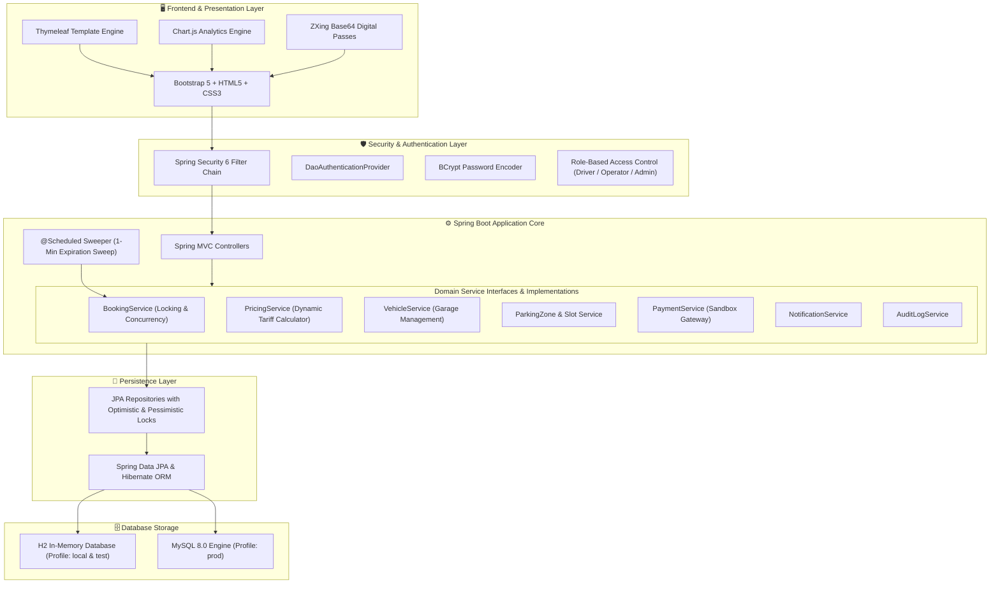

# SmartPark - System Architecture

## Architectural Highlights
1. **Separation of Concerns:** Strict layered design from controller -> service (interfaces + implementations) -> repository -> entities. Views consume clean DTOs and view models.
2. **Double Booking Prevention:** Combines pessimistic database row locking (`findByIdWithPessimisticLock`) with JPA `@Version` optimistic concurrency control and an overlapping temporal range query.
3. **Automated Expiry Sweeper:** Background cron daemon sweeping every 60 seconds to release un-checked-in slots past the 15-minute grace window.
4. **Dynamic Tariff Engine:** Evaluates duration, vehicle type, and zone overrides with a 15-minute free grace window and ceiling rounding.
